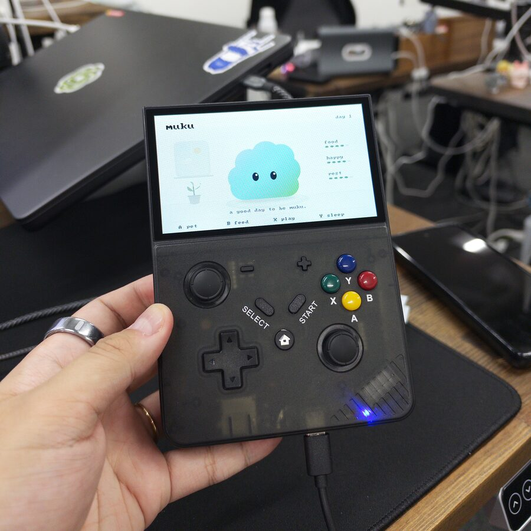
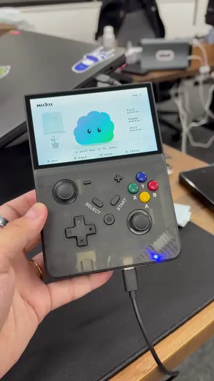
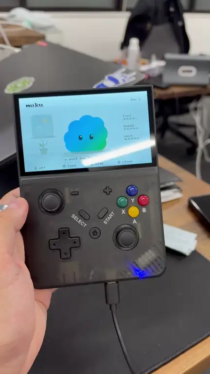
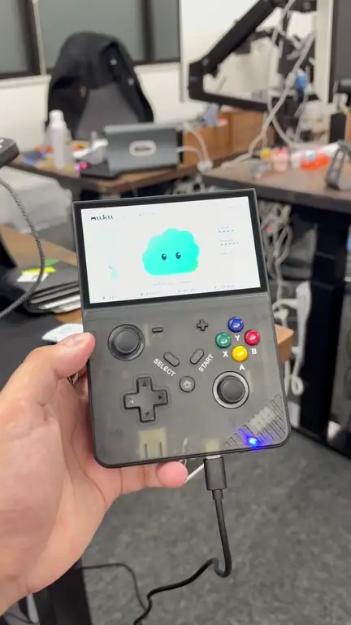
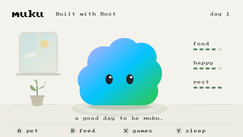
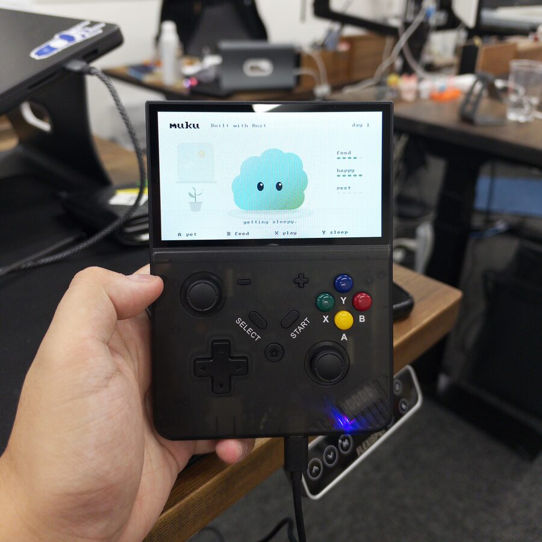
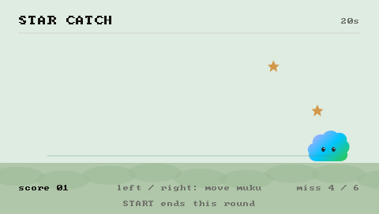
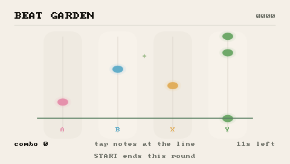
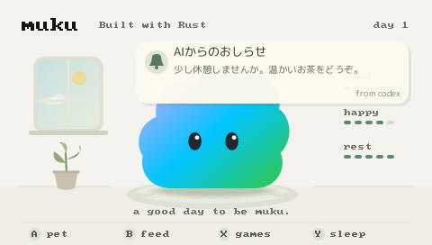

<div align="center">

[English](README.md) · **日本語** · [简体中文](README.zh-CN.md)



# tamago-muku

**ポケットサイズのゲーム機で、ふわふわの muku と暮らそう ☁️**

[](#1-ビルドする)
[](#-muku-とのくらし)
[](#-対応しているゲーム機)

</div>

tamago-muku は、RK3562 / RK3326 の小さなゲーム機の中で **muku** と暮らす Rust アプリです。
画面へ直接描画するので、ネットがなくてもお世話とミニゲームを楽しめます。
Wi-Fi 内蔵の R36MAX 2 なら、AI からのおしらせを muku が届けてくれます（任意）。

## 🎬 実機で動いているところ

<div align="center">

<table>
  <tr>
    <td align="center" width="33%">
      
    </td>
    <td align="center" width="33%">
      
    </td>
    <td align="center" width="33%">
      
    </td>
  </tr>
  <tr>
    <td align="center"><b>🫧 ふだん</b><br>ゆっくり呼吸して<br>ときどきまばたき</td>
    <td align="center"><b>💗 なでる</b><br>A ボタンでなでると<br>にっこり＆ハート</td>
    <td align="center"><b>🍙 おせわ</b><br>なでる → ごはん<br>→ あそぶ</td>
  </tr>
</table>

<sub>RK3562 の 4.3 インチ機（480×272）で撮影。動画は音声なしでループ再生しています。</sub>

</div>

<details>
<summary>📺 画面キャプチャで見る</summary>
<br>

</details>

## 🐣 muku とのくらし

muku には 3 つのゲージがあります。

| ゲージ | 画面 | ふやすには |
|---|---|---|
| 🍙 おなか | `food` | ごはんをあげる |
| 💗 気分 | `happy` | なでる・いっしょにあそぶ |
| 💤 元気 | `rest` | ぐっすり眠る |

- 呼吸、まばたき、なでられたときの反応で、いつもそばにいてくれます
- ゲージは起動中の時間でゆっくり変化します
- 状態は自動で保存されます
- 電源を切っていた時間は計算しないので、**放っておいても弱ったり、いなくなったりしません** 🕊️

<div align="center">
  
  <br>
  <sub>元気が減ってくると「getting sleepy.」と教えてくれます 💤</sub>
</div>

## 🎮 あそびかた

ホーム画面では、4 つのボタンでお世話します。

| ボタン | できること |
|:---:|---|
| **A** / ↑ | 💗 なでる |
| **B** / → | 🍙 ごはん |
| **X** / ↓ | 🎮 ミニゲームをえらぶ |
| **Y** / ← | 💤 寝る・起きる |
| **START** | 💾 保存して、元のゲーム機メニューへ戻る |

<details>
<summary>ほかの画面の操作</summary>

| 画面 | 操作 |
|---|---|
| ゲーム選択 | 左右: カーソル移動、A / X: 開始、B / Y: ホーム、START: ホーム |
| STAR CATCH | 左右: mukuを移動、START: その時点でリザルト |
| BEAT GARDEN | A / B / X / Y: 各レーンの音符をタップ、START: その時点でリザルト |
| リザルト | A / X: もう一度、B / Y: ゲーム選択、START / 上下左右: ホーム |

</details>

## 🌟 ミニゲーム

<table>
  <tr>
    <td align="center" width="50%">
      
    </td>
    <td align="center" width="50%">
      
    </td>
  </tr>
  <tr>
    <td>
      <b>⭐ STAR CATCH</b><br>
      25秒間、mukuを左右に動かして落ちてくる星を拾います。
      金の星は3点。6回取り逃すとラウンド終了です。
    </td>
    <td>
      <b>🎵 BEAT GARDEN</b><br>
      4本のレーンへ落ちてくる音符に合わせ、A/B/X/Yを押します。
      判定線へ近いほど高得点、コンボでスコアが伸びます。
    </td>
  </tr>
</table>

結果は 0〜5 個の星で表示され、遊んだ分は muku の気分と元気へ反映されます。

## 💌 AI からのおしらせ（Wi-Fi モデル）

<div align="center">
  
</div>

R36MAX 2 では、LAN 内向けの HTTP Webhook を実機で確認済みです。
AI などから送ると、muku の部屋へ日本語のおしらせを表示します。

- ゲーム中は割り込まず、ホームへ戻ったときに 9 秒間表示
- WAV を添付すると、本体のスピーカーで読み上げ 🔊
- `/storage/muku/webhook.json` がなければ、これまで通り完全オフライン

受信先は `POST /webhook` で、Bearer トークンが必須です。

```json
{
  "title": "AIからのおしらせ",
  "body": "少し休憩しませんか",
  "source": "ai",
  "kind": "notice"
}
```

WAV は Base64 で添付します。
macOS の日本語音声から WAV を作り、Webhook へ送る場合:

```sh
./scripts/send-notice-tts.sh \
  --url http://R36_IP:8787/webhook \
  --config /path/to/webhook.json \
  --title "AIからのおしらせ" \
  --body "少し休憩しませんか"
```

音声は Mac の `say` と `afconvert` で生成します。標準では `Kyoko` を使います。

📖 設定、送信例、外部 Webhook を公開する場合の注意は
[Webhook通知の設定](docs/NOTIFICATIONS.ja.md)、
R36MAX 2 の SSH と配備は [R36MAX 2実機メモ](docs/R36MAX2.ja.md) にあります。

## 🗣️ Grok とおしゃべり

Mac 上でローカル会話画面を動かし、Grok の返答を muku へ表示・読み上げられます。

```sh
# 初回だけ
security add-generic-password -U -a kan -s tamago-muku-xai -w
./scripts/install-xai-bridge.sh http://R36_IP:8787/webhook
```

その後、Mac で <http://127.0.0.1:8790> を開きます。

- API キーは macOS Keychain から読み、ブラウザや R36 へ渡しません
- Web 検索の有無を会話ごとに選べます
- Grok の返答を xAI TTS で日本語 WAV へ変換します
- MUKU の既存 Webhook トークンで R36 へ表示・音声を送ります
- LaunchAgent は最小環境で起動し、不要なセッション秘密情報を継承しません

📖 詳細は [xAI会話ブリッジ](docs/XAI.ja.md) にあります。

## 📟 対応しているゲーム機

|  | RK3562 4.3 インチ機 | XiFan R36MAX 2 |
|---|---|---|
| SoC | RK3562（Cortex-A53） | RK3326（Cortex-A35） |
| 画面 | 480×272 | 1024×768（480×272 の UI を拡大） |
| つなぎかた | USB（adb） | Wi-Fi（SSH） |
| 自動起動 | SD カードから | EmulationStation より先に表示 |
| おしらせ・TTS | — | ✅ |
| 実機メモ | [ハードウェアメモ](docs/HARDWARE.ja.md) | [R36MAX 2実機メモ](docs/R36MAX2.ja.md) |

<details>
<summary>✅ 実機で確認済みの範囲</summary>

2026-10-20 に、USB 接続した RK3562 の 4.3 インチ機で次を確認しました。

- 480×272 の DRM 描画と 3 つの evdev 入力
- 8 秒で 160 フレーム（約 20fps）の描画
- A/B/X/Y による操作
- 終了後に純正メニューへ戻ること
- SD カードからの自動起動
- 本体上での状態・保存・Linux 描画処理のテスト 13 件

2026-10-20 には R36MAX 2（RK3326、1024×768、EmuELEC 4.7）でも次を確認しました。

- Ports 起動用エントリの配置と、表示所有権を切り替えた実機起動・終了
- A/B/X 入力と、本体への状態保存
- 1024×768 で 18 秒・331 フレーム（約 18fps）の描画
- 再起動時に EmulationStation より先へ muku を自動表示
- Webhook の `202 Accepted` 受信
- 独立した Dropbear SSH サービスの公開鍵認証

Linux 向け Clippy、Rust テスト 23 件、aarch64 静的ビルドも通しています。

</details>

## 🛠️ つかいかた（開発者向け）

### 1. ビルドする

```sh
rustup target add aarch64-unknown-linux-musl
cargo test
cargo build --locked --release --target aarch64-unknown-linux-musl
```

`.cargo/config.toml` で Rust 付属リンカーと Cortex-A53 向けのリンカー修正を指定しています。
32bit のユーザーランドでも、実機の 64bit カーネル上で動作します。

### 2. 画面だけ確認する

```sh
cargo run -- --preview /tmp/muku.png
cargo run -- --preview-game select /tmp/games.png
```

### 3. USB で一時起動する

```sh
./scripts/run-usb.sh YOUR_ADB_SERIAL
```

`YOUR_ADB_SERIAL` は `adb devices -l` で確認した対象機器のシリアルへ置き換えます。
アプリを `/tmp/muku/` へ転送し、終了時に純正メニューを再開します。
内蔵 NAND と SD 上の起動スクリプトは変更しません。
一時起動の保存データは `/tmp/muku/state.json` にあり、電源を切ると消えます。

### 4. SD から起動する

<details>
<summary>SD カードへのインストールと元に戻す方法</summary>

SD の `/muku/muku-pet` がアプリ、`/muku/state.json` が保存データです。
純正の `/simulator/3562/em_ui.sh` を `em_ui.before-muku.sh` へ控え、
SD 上の入口から muku を起動します。
START またはアプリの失敗時には元のゲーム機メニューへ戻ります。

カード内のゲームや ROM、内蔵ファームウェアは変更しません。
SD を取り外して起動した場合は、元の内蔵メニューが動きます。

macOS で、書き込み可能にマウントした対象カードへ配置します。
`YOUR_SD_VOLUME_UUID` は `diskutil info /Volumes/Untitled` の
Volume UUID へ置き換えます。

```sh
python3 scripts/install-sd.py \
  --volume /Volumes/Untitled \
  --expected-uuid YOUR_SD_VOLUME_UUID \
  --binary target/aarch64-unknown-linux-musl/release/muku-pet \
  --install
```

元の起動スクリプトへ戻す場合:

```sh
python3 scripts/install-sd.py \
  --volume /Volumes/Untitled \
  --expected-uuid YOUR_SD_VOLUME_UUID \
  --restore
```

アプリと muku の保存データは残ります。
起動スクリプトがインストーラー以外で変更されていた場合、自動上書きは拒否します。

</details>

### 5. SD 上のアプリを更新する

<details>
<summary>USB 経由で更新する方法</summary>

SD を本体へ入れて USB 接続した状態で使います。
現在の配置とハッシュを確認し、旧バイナリを控えてから更新します。

```sh
python3 scripts/update-usb.py --serial YOUR_ADB_SERIAL \
  --binary target/aarch64-unknown-linux-musl/release/muku-pet --restart
```

`--restart` を付けると、muku の状態を保存して本体を再起動します。

</details>

### 🗂️ 構成

- `src/state.rs`: 状態、時間経過、検証、原子的な保存
- `src/render.rs`: tiny-skia による画面と文字の描画
- `src/app.rs`: 画面遷移と入力処理
- `src/minigame.rs`: STAR CATCH と BEAT GARDEN
- `src/device.rs`: evdev 入力と約 20fps の実行ループ
- `src/drm_display.rs`: DRM/KMS 描画と後片付け
- `src/notifications.rs`: トークン認証付き Webhook 受信
- `src/audio.rs`: Webhook 添付 WAV の非同期再生
- `scripts/xai_muku_bridge.py`: Grok 会話、Web 検索、xAI TTS、MUKU 転送

## ⚠️ いまできないこと

- 会話 AI の生成、成長段階、音、Webhook 以外の同期はまだありません。
- Webhook は LAN 向けの平文 HTTP です。インターネットへ直接公開しません。
- TTS 単体は端末へ内蔵していません。現在の TTS 送信ツールは macOS 音声を使います。
- 通知キューは再起動後には残りません。
- R36MAX 2 では 480×272 の UI を 1024×768 へアスペクト比維持で拡大し、上下を余白にしています。
- R36MAX 2 の USB OTG データ接続は未解決です。現在の配備と SSH は Wi-Fi を使用します。
- NAND 先頭のローダー領域は未取得です。ファームウェア書き換えには進んでいません。
- SD の exFAT は電源断への完全な耐性を保証しません。保存後に通常の電源操作を行います。

## 📜 出典とライセンス

muku の形、色、目、呼吸、瞬きは、
[mukumoのmobile版Muku.tsx](https://github.com/TSUQREA/mukumo/blob/0d0b8d7e89069a99fef4f810d0c3688fd813f2cd/apps/mobile/src/components/Muku.tsx)
と[ブランド仕様](https://github.com/TSUQREA/mukumo/blob/0d0b8d7e89069a99fef4f810d0c3688fd813f2cd/docs/design/brand.md)
を確認して移植しています。
標準の muku に口、ほっぺ、手足、衣装は追加していません。

通知の日本語表示には
[M PLUS Rounded 1c Regular](assets/fonts/MPLUSRounded1c-Regular.ttf) を使用しています。
[SIL Open Font License](assets/fonts/OFL.txt) に従います。

[Linux framebuffer API](https://docs.kernel.org/fb/api.html) と
[Linux input event仕様](https://docs.kernel.org/input/event-codes.html) も参照しています。

<div align="center">
<br>
<sub>☁️ きょうも muku といっしょに、いい一日を。</sub>
</div>
