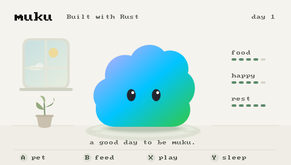

# tamago-muku — mukuのへや

RK3562の4.3インチゲーム機に、mukuが暮らす小さな部屋を置く実験。
画面には「Built with Rust」を表示します。
Rustの静的バイナリが480×272の画面を直接描き、インターネットなしで動きます。



## あそび方

| ボタン | 動き |
|---|---|
| A / 十字キー上 | なでる |
| B / 十字キー右 | ごはん |
| X / 十字キー下 | 遊ぶ |
| Y / 十字キー左 | 寝る・起きる |
| START | 保存して終了し、ゲームメニューへ戻る |

呼吸・まばたき・跳ねる動きと、食事・睡眠・なでられたときの反応があります。
おなか・気分・元気は起動中の時間でゆっくり変わります。
電源を切っていた時間を計算しないので、不在によるペナルティや死はありません。
画面のdayは、起きて一緒に過ごした時間を24時間ずつ数えたものです。
会話AI、成長段階、音、ネット同期はまだありません。

## 実機で確認した範囲（2026-10-20）

- USB adb接続先のRK3562で、480×272のDRM描画、3つのevdev入力を確認。
- 8秒の試運転で160フレーム（約20fps）。終了後、純正メニューに復帰。
- 状態・保存・Linux構造体・色順・strideの13件のテストが本体上で成功。
- 実機での目視で本体の表示とA/B/X/Yの反応を確認。
- macOSで9件の状態テスト、Linux向けClippy（警告をエラー扱い）が成功。
- SDを本体へ戻して電源を入れるとmukuが起動することを、実機での目視で確認。

## 開発

```sh
cd tamago-muku
cargo test
cargo run -- --preview /tmp/muku.png
cargo run -- --preview /tmp/muku-sleep.png --action sleep
rustup target add aarch64-unknown-linux-musl
cargo build --release --target aarch64-unknown-linux-musl
```

`.cargo/config.toml`でRust付属のリンカーとCortex-A53向けのリンカー修正を指定しています。
32bitのユーザーランドでも、実機の64bitカーネル上で動作します。

## USBで一時起動

```sh
./scripts/run-usb.sh YOUR_ADB_SERIAL
```

`YOUR_ADB_SERIAL` は `adb devices -l` の対象機器のシリアルに置き換えます。
このスクリプトは `/tmp/muku/` に転送して実行します。
純正メニューの再起動ループを一時停止し、終了時に再開します。
内蔵NANDや起動スクリプトへの書き込みはありません。
一時起動の状態は `/tmp/muku/state.json` にあり、電源を切ると消えます。
元のメニューはTERMを無視する場合があるため、メーカーと同じプロセス停止方法を使います。
一時停止中の親プロセスが回収できない終了済みの子は、稼働中と数えません。

## SDから起動

SDカードの `/muku/muku-pet` がアプリ、`/muku/state.json` が保存データです。
操作時・30秒ごと・正常終了時に保存し、書き込み途中のファイルで以前の保存を上書きしません。
SDのexFAT自体は電源断への完全な耐性を保証しないため、保存してから通常の電源操作を行ってください。

元の `/simulator/3562/em_ui.sh` を `em_ui.before-muku.sh` に控え、
その入口からmukuを起動します。STARTまたはアプリの失敗時には元のメニューを実行します。
カード内のゲームやROM、内蔵ファームウェアは書き換えません。

macOSで、書き込み可能にマウントした対象カードへインストールします。
`YOUR_SD_VOLUME_UUID` は `diskutil info /Volumes/Untitled` の Volume UUID に置き換えます。
インストーラーはUUID・exFAT・マウント先を照合し、ディスクのフォーマットや再マウントを行いません。

```sh
python3 scripts/install-sd.py \
  --volume /Volumes/Untitled \
  --expected-uuid YOUR_SD_VOLUME_UUID \
  --binary target/aarch64-unknown-linux-musl/release/muku-pet \
  --install
```

同じカードをMacにつなぎ直し、`--restore`を指定すると元の起動スクリプトに戻せます。
アプリと保存データは残します。変更後の起動スクリプトが別の内容なら、自動上書きを拒否します。

```sh
python3 scripts/install-sd.py \
  --volume /Volumes/Untitled \
  --expected-uuid YOUR_SD_VOLUME_UUID \
  --restore
```

SDを取り外した状態で起動すると、元の内蔵メニューが動きます。
本体へSDを戻す前にMacで安全に取り出してください。

## 出典と実装

mukuの形・色・目・呼吸と瞬きは、
[mukumoのmobile版Muku.tsx](https://github.com/TSUQREA/mukumo/blob/0d0b8d7e89069a99fef4f810d0c3688fd813f2cd/apps/mobile/src/components/Muku.tsx)
と[ブランド仕様](https://github.com/TSUQREA/mukumo/blob/0d0b8d7e89069a99fef4f810d0c3688fd813f2cd/docs/design/brand.md)
を確認して移植しました。標準のmukuに口・ほっぺ・手足・衣装は追加していません。
キャラクター素材に公開ライセンスが確認できたという意味ではありません。

- `src/state.rs`: ローカル状態、時間の経過、検証と原子的な保存。
- `src/render.rs`: tiny-skiaによる部屋とキャラクターの描画。
- `src/device.rs`: ボタン入力、重複入力の抑制、20fpsのループ。
- `src/drm_display.rs`: DRM/KMS画面所有、strideを考慮した色変換、後片付け。
- `src/main.rs`: 実機起動、プレビュー、状態シミュレーション。

[Linux framebuffer API](https://docs.kernel.org/fb/api.html)と
[Linux input event仕様](https://docs.kernel.org/input/event-codes.html)も参照しています。
機器の要点は `docs/HARDWARE.md` にあります。元の調査記録とバックアップは手元で別途保管しています。
NAND先頭のローダーは未バックアップなので、ファームウェアを書き換える実験には進んでいません。

## USBでSD上のアプリを更新

SDカードを本体に入れ、USB接続した状態で使います。
現在の配置とハッシュを確認し、旧バイナリとマニフェストを控えてから新しい版へ更新します。
`--restart` はmukuを保存して終了させ、本体を再起動します。

```sh
python3 scripts/update-usb.py --serial YOUR_ADB_SERIAL \
  --binary target/aarch64-unknown-linux-musl/release/muku-pet --restart
```
